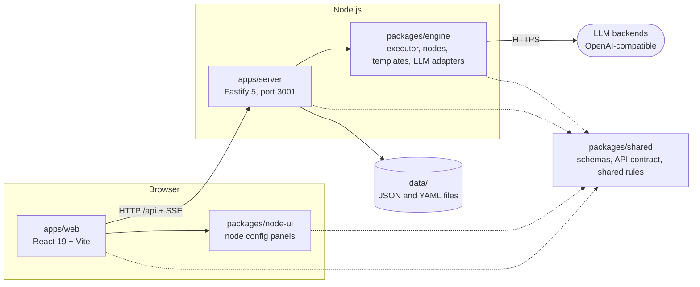
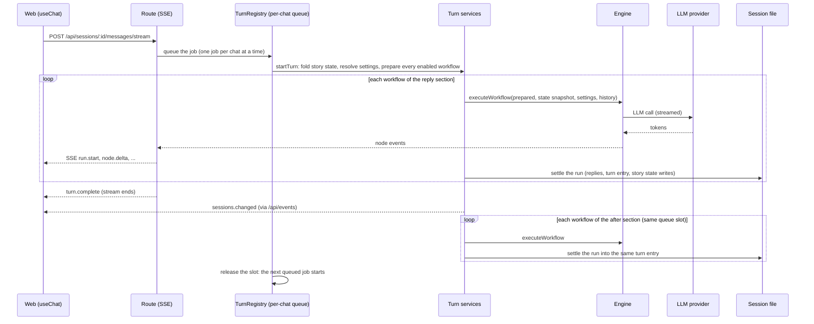
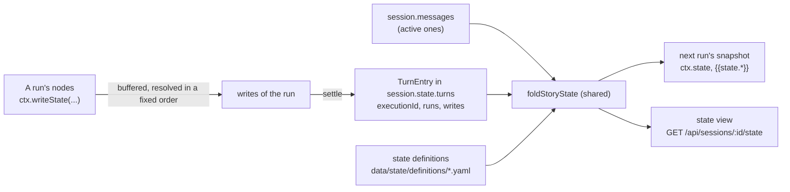
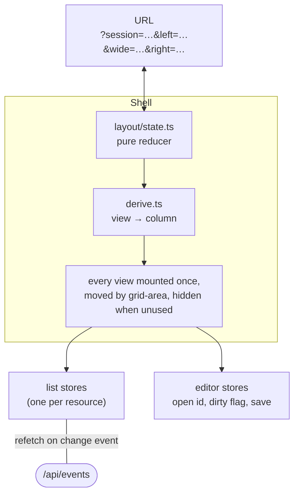

# Architecture

The big picture: what the parts are, how a message becomes a reply, and where data lives. Details per topic are in
[`reference/`](reference/); the rules to follow when changing code are in the `AGENTS.md` files.

## The parts

A single-user chat app. Each reply comes from a user-built **workflow** of nodes, run on the server. The web app is a
**thin client**: it never executes workflows, holds no secrets, and keeps no data except drafts and a few browser
preferences.

| Package | Role |
| --- | --- |
| `packages/shared` | Zod schemas and types for every record, the **API contract** (`src/api/`: request and response of every endpoint), and the pure rules both sides must agree on: port compatibility (`canConnect`), the story state fold, message links, alternatives, the fork cut, chat settings resolution, the macro registry. |
| `packages/engine` | Workflow preparation and validation, the wave-based parallel executor, Handlebars templating, preset rendering, the node types (`src/nodes/<type>/`), the LLM adapter and the tool loop. No I/O of its own besides the LLM and HTTP calls nodes make. |
| `packages/node-ui` | Node configuration forms generated from each node's JSON Schema, and custom panels for the nodes that need more. Knows nothing of the web app's routing or API clients. |
| `apps/server` | Fastify routes (thin) over services (logic): chat turns, story state, storage, secrets, imports, change events. Owns all data and secrets. |
| `apps/web` | The three-column UI: chat, workflow editor (React Flow), editors for presets, providers, state definitions, characters, personas and collections, and settings. |

The packages are consumed as TypeScript source (npm workspaces, ESM, strict). Nothing is compiled except the web
bundle.

## How a message becomes a reply

A chat holds an ordered **reply list** of workflows. Sending a message starts a **turn**: the server runs the enabled
workflows one after another, each one a **run** with its own execution log. The workflows down to the last one that
has a Chat Output form the **reply section** and are streamed; the ones below it form the **after section**, which
runs after the reply is sent.

- **One job per chat at a time.** Messages, regenerates and the after section share the chat's queue slot; different
  chats run concurrently. Stop ends whichever job holds the slot.
- **Validation before side effects.** Every enabled workflow is prepared (configs parsed, ports resolved, resources
  snapshotted) before anything is stored; an invalid workflow answers `WORKFLOW_INVALID` and stores nothing.
- **Inside a run** the engine executes the graph in waves: the nodes whose inputs are ready run in parallel. Only the
  **sinks** (Chat Output, State Write, an LLM with write tools) and what they depend on run. Each Chat Output that
  runs becomes one reply, in a deterministic order.
- **Failure keeps what was done:** replies already written are saved, and the next workflows of the list still run.
  A stop ends the list.

Details: [reference/turns.md](reference/turns.md), [reference/engine.md](reference/engine.md).

## Story state

Story state is what a chat remembers between turns. It is not stored as values but as **writes attached to the turn
that made them**; the current values are computed on every read by the **fold**, a pure function in shared.

A turn **counts** while one of its replies still exists. That single rule makes deleting a reply undo what its turn
stored, makes regenerate and swipes work (only the shown alternative's replies are active), and lets a fork copy
exactly the turns it keeps. Collection items may **link to chat messages** (summaries are such items); whether a link
still holds is computed on read too. Details: [reference/story-state.md](reference/story-state.md).

## Where data lives

Everything is files under `data/` (gitignored). User data is preserved across upgrades: schemas only grow, unknown
fields are kept, nothing is rewritten on read.

| What | Where | Format |
| --- | --- | --- |
| Chats (messages, settings, reply list, story state) | `data/sessions/` | JSON, one file per chat |
| Workflows, characters, personas | `data/workflows/`, `data/characters/`, `data/personas/` | JSON |
| Avatars | `data/avatars/` | images |
| Execution logs | `data/executions/` | JSON, one per run |
| Presets, providers, collections, state definitions | `data/presets/`, `data/providers/`, `data/collections/`, `data/state/definitions/` | YAML, editable by hand while the server runs |
| Secrets | `data/secrets.enc.json`, key in `data/.master.key` or `SECRETS_KEY` | AES-256-GCM |
| App settings, seed ledger | `data/app-settings.json`, `data/.seeded.json` | JSON |

Writes are atomic (temp file, then rename) and go through per-record locks. Every change is announced on one
server-sent event stream, `GET /api/events`, which the web's list stores listen to. Details:
[reference/storage.md](reference/storage.md).

## The web app

- Three columns: **L** (lists and narrow editors: workflows, presets, providers, state definitions, settings),
  **M** (the chat, or a wide editor: workflow or preset) and **R** (chats, characters, personas, collections, or the
  chat while a wide editor owns M). Two columns below 1000 px, one at a time on a phone.
- Views are never remounted when they move or hide, so a streaming reply, a draft or the canvas survives any layout
  change. The layout lives in the URL, so Back/Forward and reloads restore it.
- Lists come from shared stores fed by the change events; drafts stay inside their always-mounted editor.

Details: [reference/web.md](reference/web.md).

## Reference

| File | Covers |
| --- | --- |
| [reference/api.md](reference/api.md) | Every endpoint, with its status codes |
| [reference/engine.md](reference/engine.md) | Preparation, execution semantics, templates, presets rendering, the LLM node and tools, node internals, logs |
| [reference/providers.md](reference/providers.md) | Provider records, the OpenAI-compatible adapter, the wire log, model lists |
| [reference/turns.md](reference/turns.md) | The chat queue, streaming, the reply list, the after section, failures, regenerate, swipes, fork |
| [reference/story-state.md](reference/story-state.md) | Definitions, turn entries, the fold, State nodes, message links, threads, the state view |
| [reference/storage.md](reference/storage.md) | Files, YAML repositories, change events, locks, secrets, app settings, seeds, imports |
| [reference/web.md](reference/web.md) | The shell and URL, stores and editors, the workflow editor, the chat, story state in the chat |
| [TOOLING.md](TOOLING.md) | Commands, Biome, knip |
