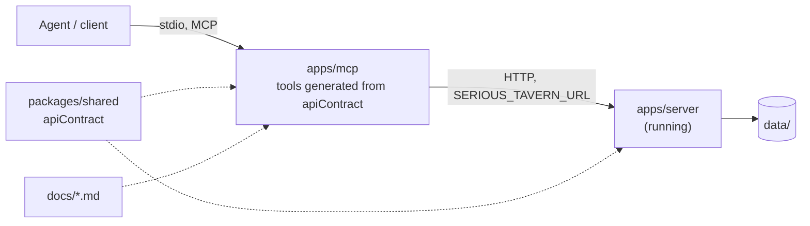

# MCP server reference

`apps/mcp` (`@st/mcp`) is a stdio [Model Context Protocol](https://modelcontextprotocol.io) server. It lets an agent
(Claude Desktop, Claude Code, Cursor...) read and write presets, workflows, characters and personas, and read
providers, models, state definitions, collections and node types. It holds no data and no logic of the app: every call
is an HTTP request to the running server. The rules to keep are in `apps/mcp/AGENTS.md`; setup for users is in
[`docs/MCP.md`](../../MCP.md).

The one constraint behind the design: adding a feature to the app must not mean maintaining the MCP. The MCP is a
projection of `apiContract` (`packages/shared/src/api/`), so a new node type or a new field on a record costs nothing,
and a new endpoint costs one line.

## From the contract to a tool

| Piece | Where | Derived from |
| --- | --- | --- |
| Which endpoints become tools | `src/expose.ts` | The only hand-written, per-endpoint code. `Record<ApiEndpoint, …>`: a new endpoint fails typecheck until it is marked `expose`, `readonly` or `{ skip: reason }`. |
| Tool name | `tools.ts` | The key in snake_case: `listProviderModels` is `list_provider_models`. |
| Description | `tools.ts` | The contract entry's `description`, with other endpoints' keys rewritten to tool names. A `list…` tool gets one more sentence: its items are summaries. |
| Input schema | `tools.ts`, `schema.ts` | `params` and `query` fields at top level, the body nested as `body`. |
| Read-only hint | `tools.ts` | `GET`, or `readonly` in the expose map (preview, validate and resolve-ports are POSTs that only read). |
| The HTTP call | `call.ts` | `method` and `path` of the entry; the same code for every tool. |

**What v1 exposes:** presets (list, get, create, update, preview), workflows (list, get, create, update, validate), node
types (list, get one, resolve ports), characters and personas (list, get, create, update), and read-only providers,
provider models, state definitions and collections. Out: deletes, secrets, chats and turns, app settings, imports,
avatars and card import/export (binary), and the event stream.

### Input schemas

Each schema is `z.toJSONSchema(…, { io: 'input', target: 'draft-07', unrepresentable: 'throw' })` over `params`,
`query` and `body`, merged into one object: `{ ...paramFields, ...queryFields, body }`. The body stays nested so that
the path `id` and a record's own `id` never collide. `body` is required when the contract's body schema does not
accept `undefined`; an endpoint whose body is `z.unknown()` ("none") gets no `body` property.

Draft-07 is the most widely understood target. `schema.ts` then removes what only adds noise: `$schema`, `propertyNames`,
the "any value" `additionalProperties`, the safe-integer bounds and the uuid regex next to `format: uuid`. It never
touches a property that happens to be named like a keyword. Schemas stay fully inline: a `$ref` would break once the
body is nested, and a test rejects `$ref`, `$defs` and `definitions` in every exposed tool.

What a schema cannot say: `superRefine` rules (a preset's input keys, depth placement) never reach JSON Schema, so an
agent learns them from the API's error messages.

### The call

`callEndpoint` checks the arguments (unknown names are refused, with a hint to use `body`; a `body` sent as a JSON
string is parsed, as some clients do), fills the path template, adds the query, sends the body as JSON, and times out
after 60 seconds. Results:

- Success: the response JSON, compact. A `204` answers `Done (no content).`. A `list…` endpoint's answer is trimmed first.
- An API error `{ error: { code, message, details? } }` becomes a tool error (`isError: true`) reading
  `Error <status> <CODE>: <message>` and, when present, `Details: <json>` (a validation error lists the failing paths; a
  `WORKFLOW_INVALID` lists the issues). An answer that is not the envelope reads `HTTP <status>: <text>`.
- Connection failure or timeout: a tool error saying the app could not be reached and how to start it.

### List trimming

The full catalog of node types is tens of kilobytes and a character's description can be pages, so one generic rule
shortens every `list…` answer (`trim.ts`): each item keeps `id` (or `type`), `name` (or `label`) and `description` (cut
to 200 characters), and an item with none of those is left as is. An object answer (a provider's model list with its
timestamp) has each of its array fields trimmed. Everything else answers in full, so `get_` tools return whole records.
The API's lists are unchanged (the web relies on them). The cost: `list_provider_models` loses context length and
pricing, and has no `get_` tool to recover them.

## Guides and the primer

`read_guide(topic)` returns one of the user guides in `docs/*.md` (`WORKFLOWS.md` is `workflows`). The topics are the
files present, found from the package's location, so it works from any working directory, and they are listed in the
tool's description and `enum`. They are a tool rather than MCP resources because clients support resources unevenly.

The server's `instructions` (`src/instructions.ts`) are a short primer shown to the model on connect: what the app is,
the create, read the save report, fix loop for workflows, that node and edge ids are chosen by the client, that preset
ids are re-derived on save, and to call `get_node_type`/`resolve_ports` before wiring edges.

## Running it

stdio only: `node <repo>/node_modules/tsx/dist/cli.mjs <repo>/apps/mcp/src/main.ts`, with `SERIOUS_TAVERN_URL` set when
the app is not on `http://127.0.0.1:3001`. Not through `npm run` or `npx`: their banner would land on stdout, which
carries the protocol. The tools do not depend on the transport, so a Streamable HTTP entry point could reuse
`createMcpServer` unchanged.

## Tests

Unit tests pin the generic behaviour: the expose map is exhaustive, tool names are unique, every exposed endpoint
has a description and an inline schema a JSON Schema validator compiles, path filling, query, error mapping, trimming,
and that no source writes to stdout. `server.test.ts` is end to end: an SDK client over an in-memory transport, the MCP
server, and the real app (`createApp` on a temp directory, listening on a free port).

## Not built yet

- Optimistic concurrency with an editor that is open on the same record (an `expectedUpdatedAt` check): today the last
  save wins, so an agent's edit can be overwritten by an open editor that has unsaved changes.
- Agents adding HTTP Request nodes to workflows already attached to a chat.
- Deletes, avatars and card import/export, secrets (never), and a Streamable HTTP transport.
